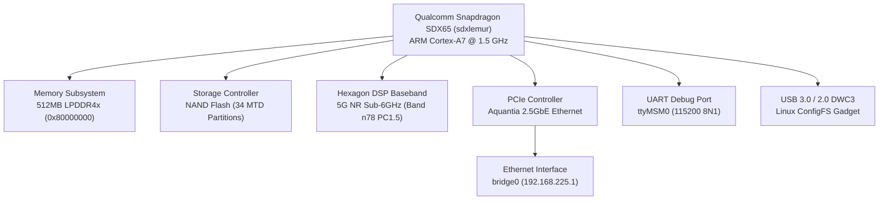
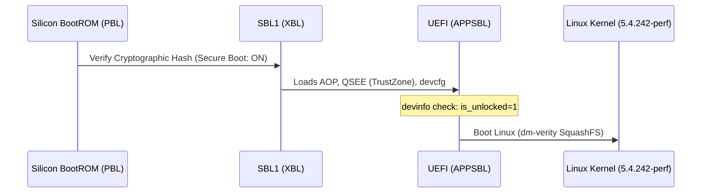

[GITHUB_FORENSIC_RESEARCH_REPORT.md](https://github.com/user-attachments/files/34222257/GITHUB_FORENSIC_RESEARCH_REPORT.md)
#  5G Outdoor Unit (JODU52140) — Technical Teardown & Forensic Research Report

## 📌 Executive Summary

This repository documents the hardware architecture, firmware structure, boot security, and communication subsystems of the **Reliance Jio 5G Outdoor Unit (Model: JODU52140)**. The device is a fixed-wireless access (FWA) CPE powered by the **Qualcomm Snapdragon SDX65/SDX62** 5G NR modem platform, manufactured by **Luxshare-ICT** with a **Quectel RG520F-JO** series cellular module.

---

## 🛠️ Hardware Specifications



| Parameter | Specification | Details |
|---|---|---|
| **Device Model** | `JODU52140` | 5G Outdoor Unit |
| **Hardware Revision** | `HW_V1.3` | Luxshare-ICT ODM Platform |
| **SoC** | Qualcomm SDX65 (`sdxlemur`) | 4nm ARMv7l Cortex-A7 @ 1.5 GHz |
| **Cellular Engine** | Quectel RG520F-JO | Sub-6 GHz 5G Standalone (SA) / NSA |
| **Firmware Build** | `JODU52140_REL_01_18_00_S` | LE.UM.6.2.3.r1-03100-SDX65.0 |
| **Ethernet Controller** | Atlantic Aquantia (`atlantic-fwd`) | Multi-gigabit 2.5 GbE backhaul |
| **Storage Architecture** | NAND Flash | 34 Partitions with UBI / dm-verity SquashFS |

---

## 🔌 Hardware Interfaces

### 1. Serial UART Console
* **Baud Rate:** `115200 8N1`
* **Device Node:** `/dev/ttyMSM0`
* **Signals:** `TX`, `RX`, `GND` (3.3V TTL)
* **Behavior:** Streams PBL, SBL1, UEFI, and Linux kernel messages. Spawns an interactive getty terminal.

### 2. USB DWC3 Interface
* **Controller:** DesignWare USB3 Core (`a600000.ssusb` / `a600000.dwc3`)
* **Operating States:**
  * **EDL Mode:** `05c6:9008` (Qualcomm Emergency Download Mode)
  * **Fastboot Mode:** `18d1:d00d` / `18d1:d001` (UEFI Bootloader Interface)
  * **Normal Gadget Mode:** `2c7c:0801` (Quectel multi-function composition: DIAG, NMEA, AT, Modem, RMNET)

---

## 🔒 Boot Chain & Security Analysis



1. **PBL (Primary Boot Loader):** Hardcoded in silicon BootROM. Verifies SBL1 signature against Qualcomm QFPROM eFuses.
2. **SBL1 (Secondary Boot Loader):** Initializes DDR training, system clocks, PMIC, and loads TrustZone (`tz.mbn`).
3. **UEFI Bootloader (APPSBL):**
   * Inspects partition table and device lock status:
     ```text
     VB: RWDeviceState: Succeed using devinfo!
     is_unlocked: 1, is_unlock_critical: 1
     VB: DeviceInit: Device is unlocked! Skipping verification!
     ```
   * While the BootROM enforces Secure Boot on raw boot stages, the UEFI stage operates with an **unlocked bootloader state** (`is_unlocked: 1`), enabling fastboot functionality.
4. **Linux Kernel (5.4.242-perf):** Uncompressed at `0x80008000`. Root filesystem mounted read-only via `dm-verity` over UBI block `ubiblock0_0` (MTD 31).

---

## 🛡️ Qualcomm EDL (9008) & Firehose Security Architecture

When the SoC enters Emergency Download Mode (`05c6:9008`), it executes code strictly from internal BootROM:

1. **Sahara Protocol Initialization:** The host initiates communication using `SAHARA_HELLO_ID` (Command `0x01`).
2. **Programmer Request:** The BootROM requests `prog_firehose_lite.elf` (Image ID `0x0D`):
   * ELF Header (`0x34` bytes)
   * Program Header Table (`0x200` bytes)
   * Segment 1: MBN Metadata & Hashes (`0x1000` bytes)
   * Segment 2: X.509 Certificate Chain (`0xC10` bytes)
3. **Root of Trust Enforcement:**
   * Generic firmware packages (e.g. `A03`, `A04`) contain programmers signed by **Qualcomm Test Keys** (`CN=SecTools Test User`, `CN=Generated Test Root CA`).
   * The hardware eFuses on the JODU52140 board are blown with **Jio / Luxshare Production Root CA** keys.
   * Because the Public Key Hash (PK Hash) does not match the eFuse hash, the hardware BootROM halts execution, resulting in an unrecoverable `errno 110 (Connection timed out)`.

---

## 💻 USB Gadget & AT Port Restoration

In the stock `REL_01_18_00_S` production firmware, USB composition is dynamically managed by Linux ConfigFS:

### Function Mapping in Linux ConfigFS (`/sys/kernel/config/usb_gadget/g1`)
* `functions/diag.diag` -> `/dev/ttyUSB1` (Qualcomm DIAG / QXDM)
* `functions/cser.nmea.1` -> `/dev/ttyUSB2` (GPS / NMEA)
* `functions/cser.dun.0` -> `/dev/ttyUSB3` (**Modem AT Command Interface**)
* `functions/cser.dun.2` -> `/dev/ttyUSB4` (Data Modem Interface)
* `functions/gsi.rmnet` -> `wwan0` (5G QMI / RMNET Network Adapter)

### Manual Gadget Binding (Shell Command)
```bash
cd /sys/kernel/config/usb_gadget/g1
echo "" > UDC 2>/dev/null
rm -f configs/c.1/f*
ln -s functions/diag.diag configs/c.1/f0
ln -s functions/cser.nmea.1 configs/c.1/f1
ln -s functions/cser.dun.0 configs/c.1/f2
ln -s functions/cser.dun.2 configs/c.1/f3
ln -s functions/gsi.rmnet configs/c.1/f4
echo 0x2c7c > idVendor
echo 0x0801 > idProduct
echo "a600000.dwc3" > UDC
```

---

## 📡 Cellular Subsystem & AT Command Verification

Upon binding the gadget stack, the host exposes `/dev/ttyUSB3` as a standard GSM/3GPP Hayes AT command interface:

```text
AT Command: ATI
Response:
Quectel
RG520F-JO
Revision: RG520FJOAAR05A02M4G_OCPU_LXA
OK

AT Command: AT+QGMR
Response:
RG520FJOAAR05A02M4G_OCPU_LXA_01.200.01.200
OK
```

* **Network Class:** 5G NR Standalone (SA)
* **Primary Band:** Band n78 (3500 MHz TDD)
* **Power Class:** HPUE Power Class 1.5 (`+QPC1DOT5: 1`)
* **Default APN:** `jionet` (IPv4v6)
